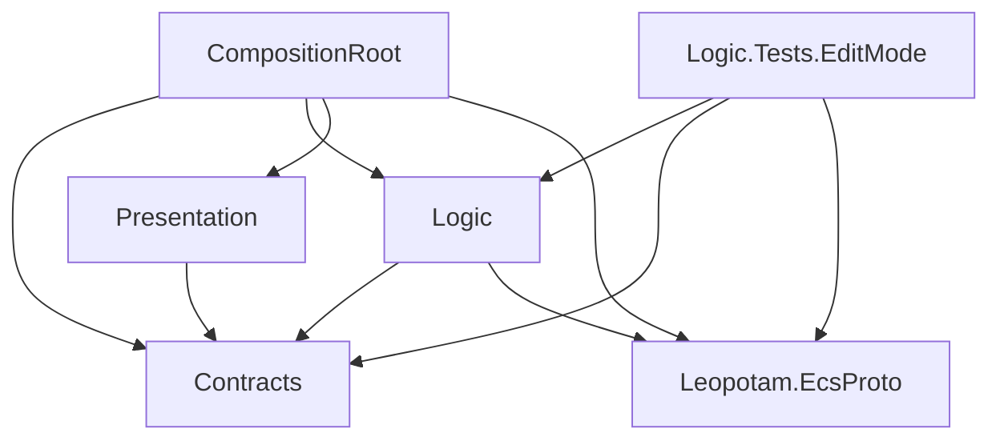

# Asteroids

Playable build: https://tainiikrab.github.io/asteroids-ecs-game/

[](https://github.com/tainiikrab/asteroids-ecs-game/actions/workflows/editmode-tests.yml)

<p>
A classic <b>Asteroids</b> arcade game recreated with Unity using an ECS-based architecture powered by Leopotam ECS.
</p>
<p>
The project focuses on clean separation between gameplay logic and the Unity presentation layer, keeping the core systems modular, testable, and engine-agnostic.
</p>
<p>
Game includes inertia-based ship movement, asteroid splitting, homing saucers, laser and bullet weapons, and seamless screen wrapping.
</p>

https://github.com/user-attachments/assets/caa7e72f-4081-46cf-bf21-bc6050bf7826

## Layout



Logic and Contracts do not reference UnityEngine.

Dependencies are wired by hand in CompositionRoot, no DI container.

`Assets/Scripts/Presentation/PlayerControls.cs` is generated by the Input System.

Unity 6000.3.7f1. The game code uses Leopotam EcsProto, Leopotam EcsProto QoL, and Input System 1.18.0.

EditMode tests are in `Assets/Tests/EditMode`. In the editor: Window > General > Test Runner, EditMode tab, Run All.

```
Unity -batchmode -nographics -projectPath . -runTests -testPlatform EditMode -testResults TestResults.xml
```

`.github/workflows/editmode-tests.yml` runs these EditMode tests on push to main.
