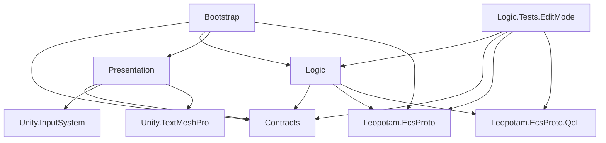

# Asteroids

Playable build: https://tainiikrab.github.io/asteroids-ecs-game/

[](https://github.com/tainiikrab/asteroids-ecs-game/actions/workflows/editmode-tests.yml)

<p>
A classic <b>Asteroids</b> arcade game recreated with Unity using an ECS-based architecture powered by Leopotam ECS.
</p>
<p>
The project focuses on clean separation between gameplay logic and the Unity presentation layer, keeping the core systems modular, testable, and engine-agnostic.
</p>
<p>
Game includes inertia-based ship movement, asteroid splitting, homing saucers, laser and bullet weapons, and seamless screen wrapping.
</p>

https://github.com/user-attachments/assets/caa7e72f-4081-46cf-bf21-bc6050bf7826

## Assemblies

`Contracts` and `Logic` set `noEngineReferences`, so those assemblies do not reference `UnityEngine`. `Presentation` and `Bootstrap` do.

`Assets/Scripts/Debug` has no asmdef. `DebugTools` compiles into the default `Assembly-CSharp` assembly.



| Assembly | Asmdef | References |
| --- | --- | --- |
| `Contracts` | `Assets/Scripts/Contracts/Contracts.asmdef` | none |
| `Logic` | `Assets/Scripts/Logic/Logic.asmdef` | `Contracts`, `Leopotam.EcsProto`, `Leopotam.EcsProto.QoL` |
| `Presentation` | `Assets/Scripts/Presentation/Presentation.asmdef` | `Contracts`, `Unity.InputSystem`, `Unity.TextMeshPro` |
| `Bootstrap` | `Assets/Scripts/CompositionRoot/CompositionRoot.asmdef` | `Contracts`, `Logic`, `Presentation`, `Leopotam.EcsProto` |
| `Logic.Tests.EditMode` | `Assets/Tests/EditMode/Logic.Tests.EditMode.asmdef` | `Logic`, `Contracts`, `Leopotam.EcsProto`, `Leopotam.EcsProto.QoL`. Editor only. `optionalUnityReferences` includes `TestAssemblies`. |

The Composition Root folder's asmdef file is named `CompositionRoot.asmdef`. The assembly name inside it is `Bootstrap`.

## Composition root

`CompositionRoot.Init` constructs `EcsBootstrap`, `UnityInputReader`, `EcsRunner`, `EcsGamePresenter`, `EcsShipUiPresenter`, and `GameStatePresenter` directly. There is no DI container in the project.

Commit `41c6031` (`refactor: cache iterators, DI with VContainer`) added VContainer and a `GameLifetimeScope`. The current `Packages/manifest.json` does not include `jp.hadashikick.vcontainer`, and the scripts do not reference VContainer.

## Input actions

`Assets/Scripts/Presentation/PlayerControls.cs` is generated by Input System 1.18.0 (`InputActionCodeGenerator`) from `Assets/Scripts/Presentation/PlayerControls.inputactions`. The generator header records that path. Regenerating the `.inputactions` asset overwrites the `.cs` file. The file stays where it is.

## Editor and packages

Unity `6000.3.7f1`, revision `696ec25a53d1` (`ProjectSettings/ProjectVersion.txt`).

Direct dependencies in `Packages/manifest.json`, aside from `com.unity.modules.*`:

- `com.unity.2d.animation` 13.0.4
- `com.unity.2d.aseprite` 3.0.1
- `com.unity.2d.psdimporter` 12.0.1
- `com.unity.2d.sprite` 1.0.0
- `com.unity.2d.spriteshape` 13.0.0
- `com.unity.2d.tilemap` 1.0.0
- `com.unity.2d.tilemap.extras` 6.0.1
- `com.unity.2d.tooling` 1.0.2
- `com.unity.collab-proxy` 2.11.3
- `com.unity.ide.rider` 3.0.39
- `com.unity.ide.visualstudio` 2.0.26
- `com.unity.inputsystem` 1.18.0
- `com.unity.multiplayer.center` 1.0.1
- `com.unity.render-pipelines.universal` 17.3.0
- `com.unity.test-framework` 1.6.0
- `com.unity.timeline` 1.8.10
- `com.unity.ugui` 2.0.0
- `com.unity.visualscripting` 1.9.9
- `ru.leopotam.ecsproto` `https://gitverse.ru/leopotam/ecsproto.git`
- `ru.leopotam.ecsproto-qol` `https://gitverse.ru/leopotam/ecsproto-qol.git`

`Packages/packages-lock.json` pins `ru.leopotam.ecsproto` to `f4ce0e9300446547ce8e213318909fcecddc867b` and `ru.leopotam.ecsproto-qol` to `8bc08acba192dd1bd2e45fee6df85704466f439e`.

## Tests

EditMode tests are in `Assets/Tests/EditMode`, assembly `Logic.Tests.EditMode`. There is no PlayMode test assembly.

In the Editor: Window > General > Test Runner, EditMode tab, Run All.

Command line, using the `6000.3.7f1` editor:

```
Unity -batchmode -nographics -projectPath . -runTests -testPlatform EditMode -testResults TestResults.xml
```

## CI

`.github/workflows/editmode-tests.yml` runs the EditMode tests with [game-ci/unity-test-runner](https://game.ci/docs/github/test-runner) `v4` on Unity `6000.3.7f1`.

The job needs three repository secrets. Creating the license file is described at https://game.ci/docs/github/activation (personal license).

- `UNITY_LICENSE`: contents of the Unity `.ulf` file
- `UNITY_EMAIL`
- `UNITY_PASSWORD`

Without them the job stops at license activation.

The playable build is GitHub Pages from the `gh-pages` branch, directory `/docs`. The Leopotam packages are git URLs, so the job clones them while Unity resolves packages.
